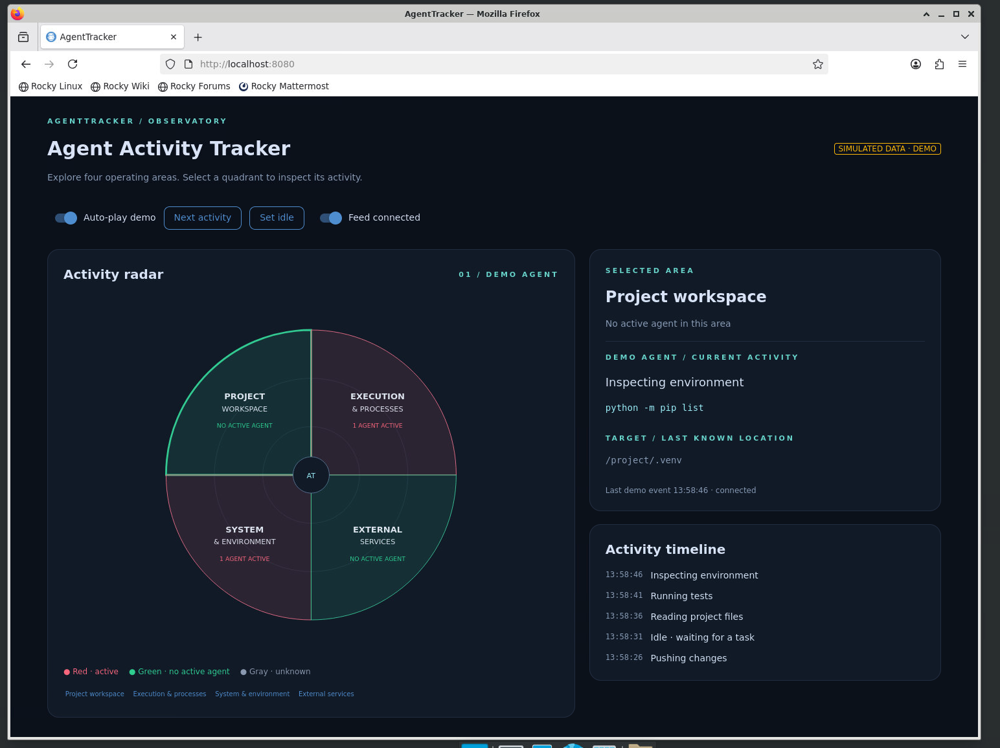
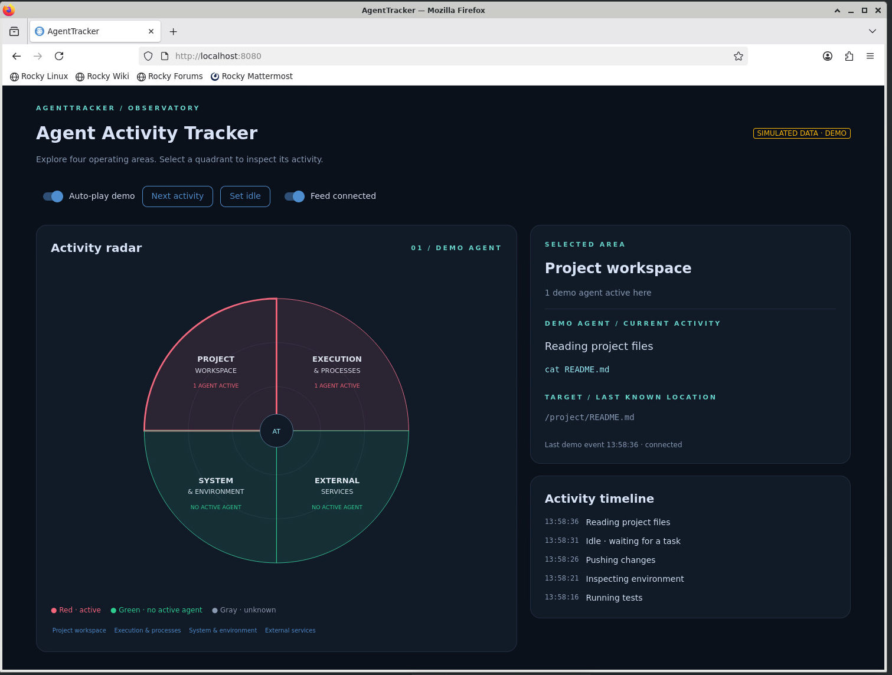

# AgentTracker proof of concept

This folder contains the **Demo_PoC**, separate from the planned production
agent tracker. It demonstrates a browser dashboard titled **Agent Activity
Tracker**, with a clickable four-quadrant radar and an activity timeline.

**There is no real agent to launch in this version.** Starting `app.py`
starts the Python backend and web server. Opening the page creates a demo
session that cycles through simulated agent activities. Displayed commands
are never executed, and `/project/` paths are fictional.

## Dashboard screenshots

The screenshots below show simulated activities in the proof of concept.

**Inspecting the environment:** the execution and system quadrants are active.



**Reading project files:** the project workspace and execution quadrants are active.



## What runs where

```text
Compute node: one Python process
┌─────────────────────────────────────────────────────┐
│ app.py                                              │
│ Simulated scenes → per-browser state → NiceGUI UI    │
│                      Python backend + web server    │
└─────────────────────────┬───────────────────────────┘
                          │ HTTP + live browser connection
                          │ SSH tunnel when using a local browser
                          ▼
Browser frontend: SVG radar + activity details + timeline
                          │
                          └── Clicks and switches → Python callbacks
```

NiceGUI serves the browser assets and handles live communication. There is
no separate frontend build or frontend server to launch. Each browser tab
has its own in-memory demo state; refreshing resets that state. The current
prototype has no process collector, filesystem watcher, agent integration,
or SQLite database. Those are proposals in `discussion-notes.txt`.

## Files

| File | Purpose |
| --- | --- |
| `app.py` | Python backend, simulated activities, and NiceGUI interface |
| `requirements.txt` | Pinned NiceGUI dependency |
| `discussion-notes.txt` | Design discussion, including proposed future components |
| `README.md` | Installation, operation, browser access, and troubleshooting |
| `png/` | Dashboard screenshots displayed in this README |

## 1. Prepare the compute environment

On the cluster, open a terminal inside an active interactive allocation or
Open OnDemand desktop. Run the app on that allocation's compute node.
Check the node name and remaining allocation time:

```bash
hostname
squeue -u "$USER" -o '%.18i %.10T %.12L %.20R'
```

Record the hostname; it can change between allocations. Examples below use
`COMPUTE_NODE` as a placeholder, not a literal hostname. The service will
stop when the allocation ends, even when running in tmux.

Change to the repository root. The commands in this guide use this root
as their working directory unless stated otherwise:

```bash
cd /projects/standard/support/shared/lamx0031/Codex/AgentTracker
```

## 2. Install the Python dependencies

Use Python 3.10 or newer. The cluster's default `python3` may be older;
Python 3.12 was used for this prototype.

For a fresh setup with pip:

```bash
python3.12 --version
python3.12 -m venv .venv
.venv/bin/python -m pip install -r Demo_PoC/requirements.txt
```

If the existing root `.venv` already contains NiceGUI, reuse it. If it was
created by uv and has no pip, use:

```bash
uv pip install --python .venv/bin/python -r Demo_PoC/requirements.txt
```

Alternatively, for a fresh uv setup, run `uv venv --python python3.12 .venv`
first, then the uv install command above. Do not recreate an environment
that is already in use by a running app.

Confirm the installed version:

```bash
.venv/bin/python -c "import nicegui; print(nicegui.__version__)"
```

The virtual environment remains at the repository root and is ignored by
Git. It does not need to move into `Demo_PoC`.

## 3. Start the backend

For a foreground run:

```bash
.venv/bin/python Demo_PoC/app.py
```

Leave this terminal open. The expected startup message is:

```text
NiceGUI ready to go on http://127.0.0.1:8080
```

The default bind address is `127.0.0.1` and the default port is `8080`.
From another terminal on the same compute node, verify the server:

```bash
curl -s -o /dev/null -w 'HTTP status: %{http_code}\n' http://127.0.0.1:8080/
```

A working server returns `HTTP status: 200`.

### Keep the backend running with tmux

Use tmux instead of a tool-owned terminal for an ongoing demo. Start only
one server on the selected port. If a foreground server is already running,
stop it with Ctrl+C before starting this alternative:

```bash
tmux -L agenttracker new-session -d -s dashboard \
  -c /projects/standard/support/shared/lamx0031/Codex/AgentTracker \
  '.venv/bin/python Demo_PoC/app.py'
```

Inspect or attach to the session on the same compute node:

```bash
tmux -L agenttracker list-sessions
tmux -L agenttracker capture-pane -pt dashboard
tmux -L agenttracker attach -t dashboard
```

Detach while leaving the app running by pressing **Ctrl+B**, releasing both
keys, then pressing **D**. tmux does not extend the Slurm job's lifetime.
If a `dashboard` session already exists, inspect it rather than starting
another one.

## 4. Open the browser frontend

### Browser inside the compute node's remote desktop

If Firefox is running on the same node as the app, open:

**http://localhost:8080**

No SSH tunnel is needed in this case.

### Browser on your own computer

`localhost` in this browser means your own computer. First open a terminal
on your computer and create a tunnel to the node where the backend runs.
Replace `COMPUTE_NODE` with the hostname recorded in step 1:

```bash
ssh -N -L 8080:127.0.0.1:8080 lamx0031@COMPUTE_NODE
```

If the compute node requires a jump through a cluster login host, replace
`LOGIN_HOST` with your usual SSH login hostname:

```bash
ssh -J lamx0031@LOGIN_HOST -N \
  -L 8080:127.0.0.1:8080 lamx0031@COMPUTE_NODE
```

Keep the SSH terminal open, then browse to **http://localhost:8080**.
The tunnel must terminate on the compute node running the app. Forwarding
to a login node's localhost will not reach this service.

If local port 8080 is occupied, use a different local port while retaining
the backend's port:

```bash
ssh -N -L 8081:127.0.0.1:8080 lamx0031@COMPUTE_NODE
```

Then open **http://localhost:8081**.

## 5. Explore the demo

- Click a quadrant or its area button to select it.
- Red means demo activity is present; green means no active demo agent in
  that area; gray means the simulated feed is disconnected/unknown.
- The proposed categories are Project workspace, Execution & processes,
  System & environment, and External services. One action may activate
  multiple quadrants.
- Auto-play advances the demo approximately every five seconds. Turn it
  off to inspect a state or use **Next activity** to advance manually.
- **Set idle** clears active highlights and retains the last known target.
  Disable auto-play first to keep the demo idle.
- Turn **Feed connected** off to simulate stale data, then on to reconnect.
  This switch is a demo control, not a real network monitor.
- The details panel shows the selected area's status and the demo agent's
  current action. The timeline displays the five most recent entries.

## 6. Stop, edit, and restart

For a foreground run, press **Ctrl+C** in its terminal. For tmux, attach
and press Ctrl+C, or stop just this dedicated dashboard session:

```bash
tmux -L agenttracker kill-session -t dashboard
```

Automatic code reload is disabled. After editing `Demo_PoC/app.py`, stop
and restart the backend, then refresh the browser. Use the new path in all
launch commands; the former root-level `app.py` has moved.

## Troubleshooting

| Symptom | Check or action |
| --- | --- |
| Firefox cannot connect | Check the Python process and allocation, then run the curl check on the compute node. For a local browser, also check the tunnel. |
| Port already in use | Inspect `ss -ltnp 'sport = :8080'`; reuse the existing server or select another port. |
| Need another backend port | Run `.venv/bin/python Demo_PoC/app.py --port 8081` and update the browser URL or tunnel destination. |
| tmux session missing | Verify you are on the same compute node; an ended allocation may have stopped it. |
| `No module named nicegui` | Use the root `.venv/bin/python` and install `Demo_PoC/requirements.txt` into that environment. |
| Python syntax/version error | Check `.venv/bin/python --version`; use Python 3.10 or newer. |
| Changes do not appear | Restart the backend and refresh the page. |
| `/project/` does not exist | It is an example path from the simulated feed. |

## Production work still needed

A production tracker will need an agent adapter for actual command/tool
and session events, process/filesystem observations, reliable activity
attribution, shared persistent state, and reconnect handling. Launching a
real AI agent beside this demo will not automatically connect it to the
radar. This folder preserves the interface proof of concept independently
of that future implementation.
